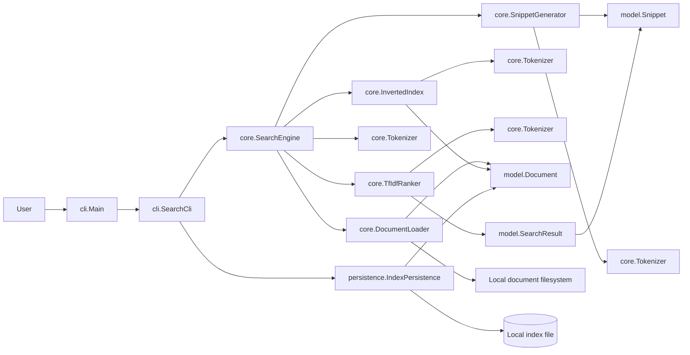
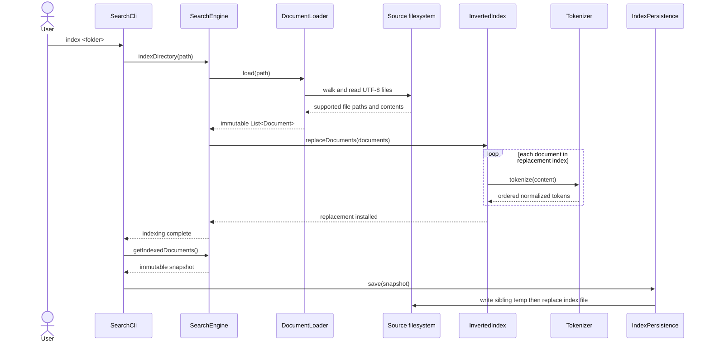
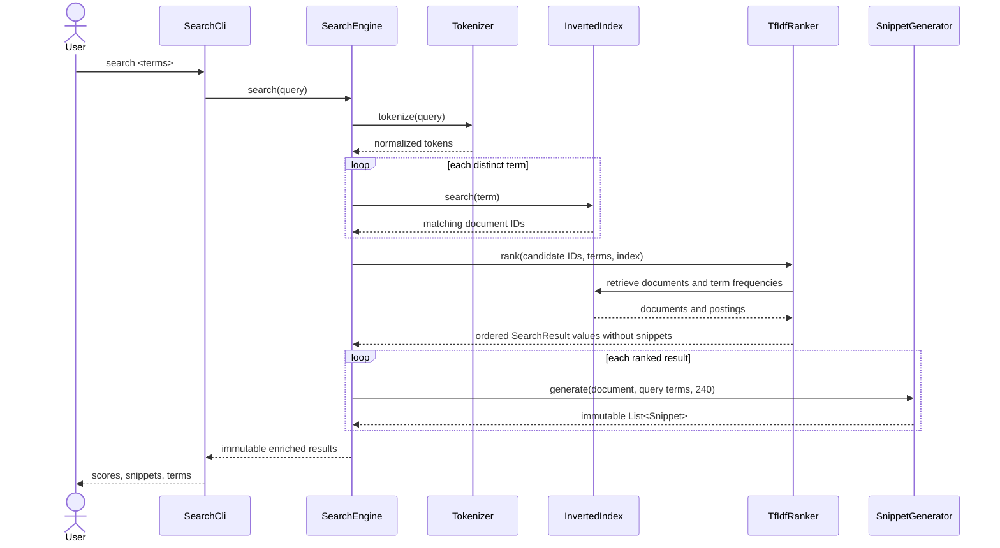
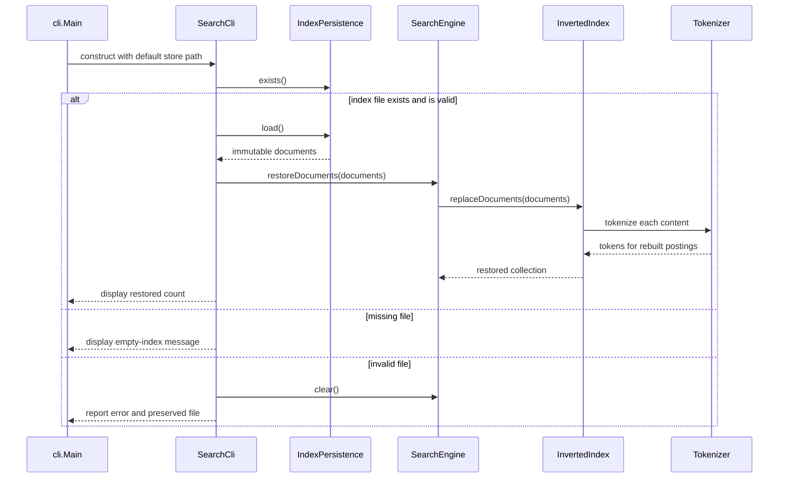

# MiniSearch architecture

This document describes the implementation currently in `src/main/java/com/ayush`. The CLI coordinates user commands, `SearchEngine` coordinates the search pipeline, and persistence remains in the CLI-facing layer.

## High-level architecture

The tokenizer appears in multiple dependency edges because each component can be constructed with its own instance. The default instances implement the same normalization contract. `SearchEngine` does not call persistence; `SearchCli` loads and saves snapshots.

## Component responsibilities

| Component | Responsibility and important state | Public surface and dependencies | Deliberately outside its responsibility |
| --- | --- | --- | --- |
| `com.ayush.cli.Main` | Creates the standard engine and persistence store, then starts the CLI. | `main(String[])`; uses `SearchEngine`, `IndexPersistence`, and `SearchCli`. | Command parsing and index logic. |
| `com.ayush.cli.SearchCli` | Reads commands, reports errors, displays results, restores persistence at startup, and saves after a successful index command. Holds the engine, streams, optional persistence, and a startup-initialized flag. | Constructor injection; `run()`. | Tokenization, postings, ranking, and file parsing. |
| `DocumentLoader` | Recursively finds supported files and turns their original UTF-8 text into `Document` records. | `load(Path) throws IOException`; uses Java NIO and `Document`. | Tokenization, ranking, persistence, and unsupported file parsing. |
| `Tokenizer` | Lowercases text and splits it into letter/digit tokens. | `tokenize(String)`; uses `Locale.ROOT` and regex. | Stop-word removal, stemming, and indexing. |
| `InvertedIndex` | Holds `term → document ID → frequency` postings and the document registry. Its maps are replaceable internally to support prepared collection replacement. | `addDocument`, `replaceDocuments`, `removeDocument`, `search`, `getTermFrequency`, `getDocument`, counts, snapshot, `clear`; uses `Tokenizer` and `Document`. | File loading, ranking, snippets, and persistence encoding. |
| `TfIdfRanker` | Computes normalized TF, smoothed IDF, candidate scores, and stable ranking. Holds a tokenizer. | `calculateTf`, `calculateIdf`, `calculateScore`, `rank`; queries the `InvertedIndex`. | User query parsing, file reading, and snippets. |
| `SnippetGenerator` | Finds whole-token matches and creates bounded, non-overlapping context snippets. Holds a tokenizer. | `generate(Document, Set<String>, int)`; creates `Snippet` records. | Ranking or index mutation. |
| `SearchEngine` | Coordinates directory replacement, query normalization, OR candidate gathering, ranking, snippet generation, snapshots, and restoration. Holds injected collaborators. | Constructors; `indexDirectory`, `search`, `getIndexedDocumentCount`, `getIndexedDocuments`, `restoreDocuments`, `clear`. | CLI rendering and disk format. |
| `IndexPersistence` | Encodes and validates persisted document records and replaces the index file safely. Holds the configured path. | `save(Collection<Document>)`, `load()`, `exists()`, `path()`, `defaultPath()`. | Tokenization, posting-list storage, ranking, and CLI messaging. |
| `Document` | Immutable original document ID, path, and text. | Record accessors and constructor validation. | Reading, tokenizing, or ranking. |
| `SearchResult` | Immutable document, finite non-negative score, matched terms, and snippets. | Record accessors; defensive copies of collections. | Score calculation. |
| `Snippet` | Immutable passage, original offsets, line range, and matched terms. | Record accessors and constructor validation. | Finding matches or rendering. |

## Data flow

### Index a directory

1. `SearchCli` parses the argument as a `Path` and checks that it exists and is a directory.
2. `SearchEngine.indexDirectory` asks `DocumentLoader.load` to discover and read the entire tree.
3. `DocumentLoader` ignores unsupported extensions and non-regular files, constructs relative forward-slash IDs, and returns an immutable list sorted by ID.
4. `SearchEngine` calls `InvertedIndex.replaceDocuments` with the loaded list.
5. `replaceDocuments` first builds a separate index by calling the normal `addDocument` method for every document. `addDocument` uses the index's tokenizer to compute frequencies. Only after preparation succeeds are the new document and posting maps installed.
6. If configured, the CLI saves `SearchEngine.getIndexedDocuments()` with `IndexPersistence`.

### Search

1. `SearchEngine.search` rejects null and tokenizes the query.
2. A `LinkedHashSet` removes duplicate normalized terms while retaining encounter order.
3. The engine calls `InvertedIndex.search(term)` for every query term and unions the resulting IDs (OR matching).
4. `TfIdfRanker.rank` loads each candidate document, finds its matched query terms from postings, computes its score, and sorts by descending score then ascending ID.
5. The engine calls `SnippetGenerator.generate` for each ranked result and returns an immutable result list with the same score and order.

### Restore at startup

`cli.Main` constructs the default `IndexPersistence` path. Before reading commands, `SearchCli` checks `exists()`. If present, it calls `load()`; only after all records validate does it call `SearchEngine.restoreDocuments`. That method delegates to `InvertedIndex.replaceDocuments`, rebuilding postings through the tokenizer. Missing storage starts empty. Corrupt/incompatible storage is reported, the in-memory engine is cleared, and the file is left unchanged.

### Save after indexing

The CLI saves only after `SearchEngine.indexDirectory` succeeds. `IndexPersistence.save` validates the input collection and IDs, serializes a complete document snapshot, creates a temporary sibling, writes and closes it, then attempts an atomic replacement. It uses a regular replacement move only when atomic moves are unsupported. See [Persistence](PERSISTENCE.md).

## Design decisions reflected in the code

- **Inverted index:** term lookups use postings instead of tokenizing every stored document for each query. Ranking still uses the document content for normalized TF.
- **Dependency injection:** `SearchEngine` accepts its collaborators; `SearchCli` accepts the engine, streams, and optionally persistence. This supports isolated tests and keeps user I/O out of the core.
- **Separate ranking:** `SearchEngine` retrieves OR candidates while `TfIdfRanker` calculates TF-IDF scores and sorts results.
- **Immutable models:** `Document`, `SearchResult`, and `Snippet` are records. Collections are copied before being exposed.
- **Replacement semantics:** indexing a root represents a complete snapshot of that root. Preparation happens in a temporary index before the active maps are replaced.
- **Rebuild postings on restore:** only document fields are persisted. The normal index path rebuilds normalized terms and frequencies, avoiding duplicated persistence logic for internal maps.
- **Versioned custom format:** an explicit format ID and version permit incompatible files to be rejected clearly; Base64 makes each UTF-8 field safe as one line.
- **Atomic file replacement:** a completed temporary file is moved over the saved index to avoid writing partial contents directly into the current index.

The last two rationales follow directly from the implementation structure; the code does not claim crash-proof durability, checksums, or multi-process coordination.
